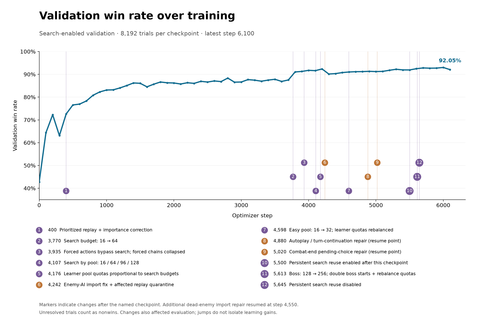
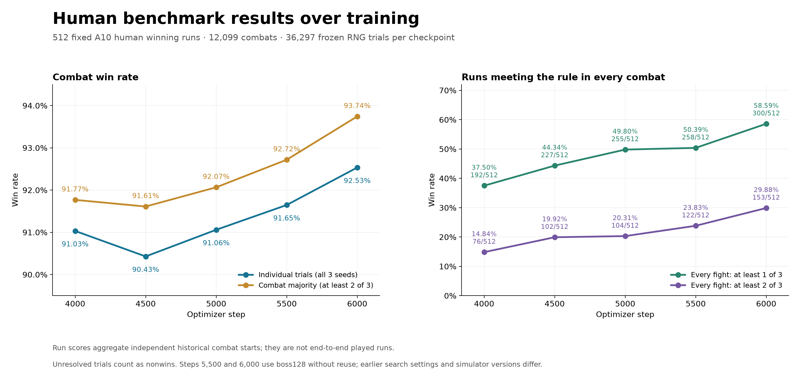

# OstyAI

**Building toward superhuman Slay the Spire 2 play, starting with Necrobinder A10 combat.**

The long-term goal is a model that plays the full game at a superhuman level. The proposed path has two stages: first train a strong, fast **combat model**, then train a **run-decision model** for choices such as pathing, card rewards, shops and deck building. This repository focuses on the first stage. Superhuman combat is the goal; the current results do not establish that level of play.

OstyAI combines a modified Rust simulator, a small policy/value transformer, Gumbel search with belief draws, and an AlphaZero-style training loop. It includes the step-5500 model, frozen benchmark inputs, recorded results, training code and provenance. Full training datasets are not included.

**Built on [Thomas Friedel's spire-mentor](https://github.com/tfriedel/spire-mentor)** and its `sts2-rs` simulator. The original combat engine, content, MCTS and belief-draw implementation are upstream work. See [credits and licensing](#credits-and-licensing).

## Table of contents

- [Motivation: why combat comes first](#motivation-why-combat-comes-first)
- [A shared human-run combat benchmark](#a-shared-human-run-combat-benchmark)
- [Current results](#current-results)
- [Training progress](#training-progress)
- [Model architecture](#model-architecture)
- [Training scheme](#training-scheme)
- [Changes relative to the Rust simulator](#changes-relative-to-the-rust-simulator)
- [Low-budget search through chance nodes](#low-budget-search-through-chance-nodes)
- [Future directions and open questions](#future-directions-and-open-questions)
- [Quick start](#quick-start)
- [Repository guide](#repository-guide)
- [Credits and licensing](#credits-and-licensing)

Use the table of contents to jump to a section. Expand the panels below for technical details and plots; the current results and quick start remain visible.

## Motivation: why combat comes first

<details>
<summary>Read the motivation: Necrobinder, combat strength, and throughput</summary>

### Why Necrobinder?

I am a Necrobinder main, so my initial focus is an **Ascension 10 Necrobinder combat model**. Necrobinder also looks like a demanding test case: spire-mentor's October 2026 evaluation reports a **5.6% A10 full-run win rate**, the lowest of its five characters, using 8,000 MCTS simulations per decision and 500 runs per A10 result. This describes that system's performance, rather than proving an intrinsic difficulty ranking. My hypothesis is that improvements on Necrobinder's difficult combat decisions will transfer usefully to other characters. [Upstream results](https://github.com/tfriedel/spire-mentor#numbers).

### Combat strength shapes what the run model learns

A run-decision model learns strategies that depend on what its combat model can execute. If the combat model cannot find winning ideas that strong humans use—such as infinite combos, exhaust loops or other long-horizon strategies—the run model may never learn to build decks around them. That can prevent the full system from reaching superhuman strength.

In my earlier full-run training experiment with a weak combat model and no search, the run model learned to avoid Act 1 elites. The combat model consistently lost enough HP that relic and card rewards did not appear worthwhile. The full-run model plateaued at roughly **1% A10 win rate**, with only about **50% of runs getting out of Act 1**. These are observations from that earlier experiment, not results from the combat benchmark below.

### Strength must come with throughput

Full-run training also depends on how many combats the combat model can finish per second. Even a search method that finds excellent moves may be impractical for training a run model if each in-game decision takes minutes. The aim is to approach superhuman combat strength while retaining enough throughput to train the next stage.

For scale, the included 512-combat diagnostic measured roughly **616–644 played decisions/second** without persistent search reuse on an NVIDIA L40 with 80 workers. Those are short diagnostic measurements, not full human-benchmark runtimes. [Measured throughput and timing definitions](docs/THROUGHPUT.md).

</details>

## A shared human-run combat benchmark

The benchmark fixes the historical deck, relics, HP and inventory for each fight, helping separate combat execution from deck-building decisions.

1. Start with human runs from the **Spire Codex** data used by this project. Select **512 complete, solo, A10 Necrobinder winning runs**, excluding modded/unrecognized cards or relics and runs that cannot be reconstructed completely in the simulator. Selection uses a fixed hash-based random ordering; model outcomes do not determine eligibility.
2. Extract **12,099 combat starts** from those runs.
3. Because the source does not record exact RNG state for each combat, generate **three distinct randomized starts per combat**, then freeze their full RNG states. Every benchmark uses the same **36,297 trials**.
4. Set starting potion-instance penalties to **0** for recorded or inferred human use in that combat, and **1** otherwise. Inference compares potion inventories with the following combat; the final fight uses final inventory and explicit use records. These penalties affect the neural agent's utility, not the definition of a win.

Each original combat was won by a human on the successful run. Winning every reconstructed fight is therefore a useful aspiration for a strong combat agent. However, different RNG and reconstruction details mean a win is **not guaranteed to exist for every randomized trial**. Conditioning on successful human runs also makes this a specific diagnostic population, not a representative sample of all A10 fights.

### What we report

| Metric | Definition |
|---|---|
| Overall trial win rate | Total won trials / 36,297, pooling all three seeds |
| Majority combat win rate | Combats won in at least 2 of 3 trials / 12,099 |
| Runs with every fight won ≥2/3 | Number and percentage of the 512 runs whose every combat meets the majority rule |
| Runs with every fight won ≥1/3 | Number and percentage of runs with at least one winning trial in every combat |
| Average HP lost | Initial minus final HP over completed trials; healing can make this negative |
| Benchmark time | Wall time for the entire benchmark, with worker count, hardware and timing scope recorded |

Capped or unresolved trials count as nonwins; they are excluded from HP-loss averages. Combat starts are independent historical reconstructions. A “run” score aggregates those fights—it is **not** an end-to-end model-played run carrying HP and inventory between combats.

**Training overlap:** the current OstyAI model may have benchmark combats in its training dataset. Human winning action sequences are not supplied as supervision: those sequences are unavailable. Training instead generates its own search targets and combat outcomes. Overlap still matters, so this benchmark is not a held-out generalization claim.

Read the [benchmark specification](docs/BENCHMARKS.md), [original selection and potion-inference notes](provenance/human-panel-original.md), and [frozen inputs](benchmarks/fixtures/human/).

## Current results

### Published model result

The exported **step-5500 model** is the best completed human-benchmark checkpoint in the included training history. It uses tiered budgets of **32 / 64 / 96 / 128** for easy / hard / elite / boss fights, with **persistent search reuse disabled**.

| Model / evaluation | Overall trial wins | Majority combat wins | Every fight ≥2/3 | Every fight ≥1/3 | Full benchmark wall time |
|---|---:|---:|---:|---:|---|
| OstyAI step 5500, historical tiered search | 33,265 / 36,297 **(91.65%)** | 11,218 / 12,099 **(92.72%)** | 122 / 512 **(23.83%)** | 258 / 512 **(50.39%)** | Not verified as an uninterrupted full-process measurement |

There were **9 unresolved trials**. Mean HP lost was **14.41 per completed trial**. The historical report contains evaluation and collection timers with different scopes; they are not substituted for the full-process timing requested for the new comparison. [Original summary](benchmarks/human-validation-005500/summary.json) · [table values and source hashes](benchmarks/readme-step5500-metrics.json).

### Matched four-agent comparison

As of **October 26, 2026**, the following comparison is in progress. Every agent uses **80 workers**, the same complete compatibility-prepared panel, and a 1,000-action combat cap. Configurations execute sequentially with production training paused. Wall time includes process startup, loading, compilation, evaluation and result writing; offline fixture preparation is excluded.

| Agent | Search budget | Trial win rate | Every fight ≥2/3 | Every fight ≥1/3 | Full wall time | Status at update |
|---|---|---|---|---|---|---|
| Mentor MCTS (RL training budget) | 250 non-boss; 1,000 boss; rollout cap 200 | Pending | Pending | Pending | Pending | Running |
| OstyAI step 5500, tiered, no reuse | 32 / 64 / 96 / 128 | Pending | Pending | Pending | Pending | Queued |
| OstyAI step 5500, uniform, no reuse | 32 for every tier | Pending | Pending | Pending | Pending | Queued |
| OstyAI step 5500, greedy policy | Zero search; legal-action argmax | Pending | Pending | Pending | Pending | Queued |

The previously proposed 8,000-simulation / rollout-400 MCTS run was removed before its full benchmark started. The current Mentor baseline retains its upstream evaluator; it does not use the neural agent's potion-penalty objective. Fixtures are made compatible offline without a runtime MCTS adapter. These new results will remain separate from the historical row above. [Comparison protocol](docs/HUMAN_COMPARISON.md).

---------------------------------------------------------------------------------------------------------------------------

## Training progress

### Primary validation win rate

<details>
<summary>Show the annotated primary-validation plot</summary>



The primary panel contains **8,192 trials per checkpoint**. Step 5500 scored **91.92% with search** and **80.09% with greedy policy only**. These primary-panel scores are distinct from the 512-run human benchmark. Search budgets and simulator repairs changed during training, so jumps in the plot do not isolate learning gains. [Matched primary results](benchmarks/validation-comparison-005500.json).

</details>

### Human benchmark over training

<details>
<summary>Show the human-benchmark training plot</summary>



The plots stop at step 5500. Persistent search reuse was enabled after that checkpoint, so these curves do not establish its effect on benchmark strength. Historical configuration and native-library identities are retained in the [validation histories](benchmarks/history/) and [provenance](PROVENANCE.md).

</details>

---------------------------------------------------------------------------------------------------------------------------

## Model architecture

<details>
<summary>Expand the architecture and component table</summary>

The model has **1,593,346 parameters** and shares an encoder between its policy and value heads.

| Component | Design |
|---|---|
| Input | Variable-length NUM1 state and legal-action records, `int32[B, S, 16]`; buckets up to 4096 rows |
| Token construction | Shared semantic embeddings, 40 signed-log1p numeric features, owner/child/reference relations and explicit potion-cost context |
| Transformer | 4 pre-layer-normalized blocks, width 128, 4 attention heads, feed-forward width 512, GELU, no dropout |
| Policy head | Action + owner + target + summary vectors → 128 → one logit per legal action; padding masked |
| Value head | Summary vector → 128 → one unconstrained shaped-return estimate; this is not a win probability |
| GPU execution | Triton token assembly for inference, autograd-compatible training, BF16 autocast, Torch compile and CUDA graphs |

The policy can act directly by selecting its highest-scoring legal action, or supply priors to Gumbel search while the value head evaluates leaves. [Architecture and tensor layout](docs/ARCHITECTURE.md) · [model implementation](ostyai/model.py) · [checkpoint metadata](models/best/metadata.json).

</details>

---------------------------------------------------------------------------------------------------------------------------

## Training scheme

<details>
<summary>Expand data generation, the training loop, pool quotas, loss, and references</summary>

The learning loop is inspired by **AlphaZero**: search improves a neural policy, and a shared policy/value network learns from search targets and combat outcomes ([Silver et al., 2018](https://doi.org/10.1126/science.aar6404)). Root action selection uses a custom adaptation of **Gumbel search**, with sampled candidates and sequential halving ([Danihelka et al., 2022, *Policy improvement by planning with Gumbel*](https://openreview.net/forum?id=bERaNdoegnO)). OstyAI uses the Rust simulator for transitions and stochastic belief draws; it is not an exact reproduction of either paper.

### Training data and generation

Training starts from a **50% human / 50% generated combat-start mixture**. This is separate from the combat-pool quotas used to sample learner batches below.

| Source | Current candidate pool | Starts requested per collection bank |
|---|---:|---:|
| Reconstructed human solo A10 Necrobinder combats | 122,489 | 512 |
| Generated combats from 100,000 random A10 Necrobinder runs | 2,807,379 | 512 |

**Human starts** come from Spire Codex run histories spanning game versions v0.109.1–v0.111.0. Standard solo A10 Necrobinder runs are filtered from the raw records, and combat states are reconstructed from inventory/history and recorded starting HP. Training includes both winning and losing runs. All 1,815 source runs of the fixed primary validation panel are excluded, removing 43,355 combats from 165,844 candidates. The separate 512-winning-run human benchmark may overlap training, as disclosed above.

**The 100k random-run dataset** was generated with 100,000 distinct seeds, A10 Necrobinder, and up to three acts, using the v0.111.0 reference. Run-level choices were randomized: paths, events, rests, upgrades, offered cards, and affordable shop purchases; relics and potions were taken, with random potion replacement when full. At each combat opening, the collector saved a restorable state **before synthetically marking the combat won** and running normal post-combat hooks/rewards. This produced 2,807,379 opening snapshots in 1,000 SQLite shards.

These are **synthetically advanced runs, not 100,000 demonstrated combat wins**. The collector did not play out fights, so its progression does not include damage from those fights, and the resulting starts are not guaranteed winnable. During training, the current actor actually plays each sampled combat in the updated Rust simulator. Search supplies policy targets and the resulting combat supplies terminal value targets; no human winning action sequence is supplied.

Banks sample uniformly within each full source pool, without replacement within a bank and independently across banks. Unsupported conversions are logged and resampled; a later native preparation pass can remove additional incompatible starts, making final banks slightly smaller than 1,024. The 10,000 prepared banks contain **10,185,462 accepted starts**: 5,119,807 human and 5,065,655 generated (including repeats across banks). Full training datasets are not bundled. [Generation details and exclusions](docs/TRAINING.md#training-data-and-generation) · [verified counts and source hashes](provenance/training-data.json).

### Collection and learner sampling

Training follows **collection → learning → actor synchronization**. A frozen actor drives 80 Rust workers through approximately 1,024 combat starts per cycle. Completed decision examples enter a **65,536-example FIFO replay buffer**. Each optimizer update samples **16,384 examples**, accumulates gradients across **64 microbatches of 256**, and synchronizes the actor. The target is 10,000 updates; the packaged model is step 5500.

| Combat pool | Simulations per non-forced decision | Samples per optimizer update |
|---|---:|---:|
| Easy / native Weak | 32 | 1,638 |
| Hard / native Normal, unclassified events | 64 | 3,277 |
| Elite | 96 | 4,915 |
| Boss | 128 | 6,554 |

Within each pool, value-error priorities are mixed with **5% uniform sampling**. Importance weights `1 / (N_pool * P(sample | pool))` correct within-pool sampling while preserving the intended 10/20/30/40% pool mixture. Quotas apply to the full optimizer update; microbatches are packed for token-length efficiency.

There is no separate human/generated quota at the learner stage. Combat length, replay retention, pool quotas, and priorities determine the final source mixture among sampled decision examples; a 50/50 mixture of starting combats does not imply 50/50 learner examples.

The loss combines importance-weighted **policy cross-entropy against the search target** and **value MSE against terminal utility**. AdamW uses learning rate `3e-4`, weight decay `1e-4`, and gradient-norm clipping at `1.0`. There is no explicit entropy bonus or distance-to-terminal loss discount.

```text
utility = win + 0.5 * (max(final_hp, 0) / initial_hp) * (1 - spent_potion_cost)
              + (0 if win else 0.05 * damage_progress)
```

The utility is unclipped and can exceed 1. Training and primary validation assign independent Uniform[0,1] potion costs; the human benchmark uses the fixed 0/1 labels described above.

Primary search and matched policy-only validation run every **100 updates**; the human benchmark runs every **500**. No learning occurs between paired primary passes. Current source supports persistent search reuse, but the published step-5500 scores and the new comparison's neural runs use no reuse. [Full training configuration](docs/TRAINING.md).

</details>

---------------------------------------------------------------------------------------------------------------------------

## Changes relative to the Rust simulator

<details>
<summary>Expand neural integration and simulator repairs</summary>

OstyAI extends spire-mentor's engine with a neural learning pipeline and targeted simulator repairs. The [difference inventory](provenance/upstream-differences.json) compares the packaged source with upstream checkout `e7a923e90dc731e83683791b6c4d4a4059656149`.

### Neural search and learning

- Rust workers export compact state/action records into pinned buffers for batched GPU policy/value evaluation.
- Custom **Gumbel sequential-halving search** considers up to eight legal root actions, uses belief draws and chance-outcome widening/reuse, and has no fixed search-depth cap.
- Sole legal actions execute immediately in search-enabled real play. Forced chains inside search collapse into the parent edge without intermediate nodes or GPU evaluation, preserving chance effects. Factual forced decisions retain replay observations and terminal targets.
- Persistent graphs can retain up to **512 nodes per combat**, reuse matching belief states and invalidate evaluations when the actor changes. Each decision still receives its full simulation budget. [Measured tradeoffs](docs/THROUGHPUT.md).
- Independent potion costs, bounded replay, within-pool priorities, learner accumulation, detailed accounting, and matched evaluation connect the simulator to training.

### Simulator repairs

- Restore ascension-aware enemy AI; migrate known obsolete Skulking Colony, Haunted Ship and Axebot openings without resetting HP, powers or RNG. Unsupported live AI fails explicitly; dead enemies are handled separately.
- Recognize Queen companion death even when a historical counter is missing.
- Complete inner autoplay/draw choices before outer turn setup resumes; reject out-of-phase EndTurn actions that would otherwise be no-ops.
- Park Tyranny / ToolsOfTheTrade continuations only when a pending choice exists, allowing lethal effects to reach combat completion.

[Simulator change details](docs/SIMULATOR_CHANGES.md) and [deployment evidence](provenance/changes/) document tests and native hashes. Historical results are never relabeled as results from a repaired or newer simulator.

</details>

---------------------------------------------------------------------------------------------------------------------------

## Low-budget search through chance nodes

<details>
<summary>Expand the Soul example and chance-versus-depth discussion</summary>

A small search budget is divided between exploring different random outcomes and looking further ahead within each outcome. For a draw card, search must answer both:

1. **What might I draw?** Sample several possible hands.
2. **What can I do with each hand?** Search subsequent actions.

Both consume the same simulation budget. More outcome samples give broader coverage of the card's value, but leave fewer simulations to discover combinations or delayed benefits.

In the recorded **32-simulation Soul example**, the chosen Soul received **13 simulations**: eight created new draw outcomes evaluated immediately by the value network, and five revisited existing outcomes and searched one action deeper. The deepest explored sequence was only **two actions**. This diagnostic used checkpoint **5460**, not the released step-5500 model, and is an example rather than a typical-depth estimate.

Consequently, low-budget search can depend heavily on the value network understanding what follows a draw. If the network undervalues a powerful combination, search may never play far enough into it to correct the estimate. Restricting the number of outcomes could allow deeper exploration, but also risks selecting actions because a few sampled draws were lucky. The challenge is balancing representative randomness against useful depth, especially when later actions introduce more chance branches.

[Follow the complete search trace](docs/SEARCH.md): all candidate scores, node values, outcome samples, backups and per-simulation results are included.

</details>

---------------------------------------------------------------------------------------------------------------------------

## Future directions and open questions

<details>
<summary>Expand research directions and open questions</summary>

These are research questions, not demonstrated improvements:

- **Depth versus randomness:** can adaptive chance widening spend a small budget on representative outcomes while still discovering long combinations?
- **Long-horizon learning:** can verified winning trajectories, targeted difficult-fight practice, or auxiliary targets improve value estimates for exhaust loops and delayed payoffs?
- **Search distillation:** how much of search's strength reaches the greedy base policy, and where does the gap remain largest?
- **Useful reuse:** can persistent search improve strength per second after accounting for cache-management overhead?
- **Benchmark validity:** how do results change on strictly held-out runs, additional frozen seeds, and stronger reconstruction/parity checks?
- **The next stage:** what combat strength and throughput are sufficient before resuming run-decision training, and how well do improvements transfer across characters?

</details>

---------------------------------------------------------------------------------------------------------------------------

## Quick start

Tested on Linux with Python 3.12, PyTorch 2.7.1+cu128, Triton 3.3.1 and Rust 1.96.0. The neural loop requires NVIDIA CUDA; the production machine uses an L40 and 80 CPU workers.

```bash
uv venv --python 3.12
uv pip install --python .venv/bin/python -r requirements.txt
export CUDA_LIB_DIR="$(.venv/bin/python scripts/cuda_link_dir.py)"
bash scripts/build_native.sh
.venv/bin/python scripts/unpack_benchmarks.py
.venv/bin/python scripts/verify_model.py
.venv/bin/python scripts/evaluate.py --suite smoke --output results/smoke
```

Use `--suite human --workers 80` for the full human benchmark or `--suite primary` for 8,192 primary trials. Add `--policy-only` to either suite for zero-search greedy legal-action selection. Search defaults to no persistent reuse; `--reuse` enables it. Use a fresh output directory for each configuration. [Reproduction guide](docs/REPRODUCING.md) · [controlled comparison protocol](docs/HUMAN_COMPARISON.md).

**The trained model is [`models/best/model.pt`](models/best/model.pt).** `ostyai/initial_weights.pt` is the original random initialization. Cloning or importing the repository does not start training. Full training corpora, replay buffers, optimizer checkpoints and machine-specific compiled binaries are excluded; frozen benchmark inputs are included.

---------------------------------------------------------------------------------------------------------------------------

## Repository guide

| Location | What to find there |
|---|---|
| [docs/](docs/README.md) | Reading paths for architecture, training, evaluation, search, throughput and simulator changes |
| [models/](models/README.md) | Exported champion weights, selection criteria, configuration and hashes |
| [benchmarks/](benchmarks/README.md) | Frozen fixtures, historical results, validation histories and timing evidence |
| [ostyai/](ostyai/) | Model, GPU pipeline, native bindings, learner, replay and evaluation code |
| [native/](native/) | Derived Rust simulator workspace and upstream MCTS implementation |
| [scripts/](scripts/README.md) | Build, unpack, verify, evaluate and comparison entry points |
| [provenance/](provenance/README.md) | Source identities, repair/deployment evidence and package verification |
| [tools/human-panel-source/](tools/human-panel-source/) | Archival benchmark-construction tools; require external source data |

---------------------------------------------------------------------------------------------------------------------------

## Credits and licensing

**Trained model weights:** [CC BY-SA 4.0](models/WEIGHTS-LICENSE.md), attributed to Maxim Oleynikov / OstyAI. Commercial use and modifications are permitted; distributed adaptations must satisfy ShareAlike. This grant covers the trained weights only.

The simulator is derived from **[Thomas Friedel's spire-mentor](https://github.com/tfriedel/spire-mentor)**, especially `sts2-rs`. Original engine copyright is **2025–2026 Thomas Friedel**. This repository does not claim authorship of the upstream engine, content, original MCTS or belief-draw machinery. The unchanged [upstream MIT license](native/LICENSE), notices and source attribution are retained.

See [ATTRIBUTION.md](ATTRIBUTION.md), [LICENSE](LICENSE) and [PROVENANCE.md](PROVENANCE.md) for the boundaries between upstream and OstyAI work. Slay the Spire 2 belongs to Mega Crit; this project is not affiliated with or endorsed by Mega Crit. No game art, audio or assemblies are distributed here.
