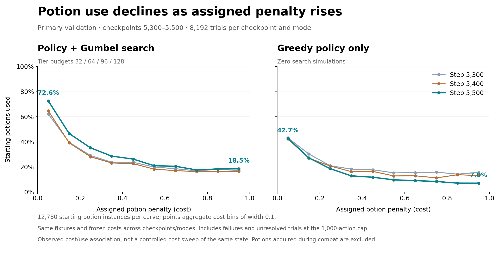

# OstyAI

**Toward superhuman Slay the Spire 2 play, starting with Necrobinder A10 combat.**

The plan is to train a strong, fast combat model, then a run-decision model for pathing, rewards, shops and deck building. This repository covers the combat model; current results do not establish superhuman play.

OstyAI combines a modified Rust simulator, a policy/value transformer, Gumbel search with belief draws, and AlphaZero-style training. It includes the **step-5500 model**, training code, frozen benchmarks and results. Full training datasets are excluded.

Built on **[Thomas Friedel's spire-mentor](https://github.com/tfriedel/spire-mentor)**, which provides the original simulator, MCTS and belief-draw implementation.

## Table of contents

- [Why combat comes first](#motivation-why-combat-comes-first)
- [Human-run benchmark](#a-shared-human-run-combat-benchmark)
- [Results](#current-results)
- [Training progress](#training-progress)
- [Model architecture](#model-architecture)
- [Training scheme](#training-scheme)
- [Simulator changes](#changes-relative-to-the-rust-simulator)
- [Search through chance nodes](#low-budget-search-through-chance-nodes)
- [Open questions](#future-directions-and-open-questions)
- [Quick start](#quick-start)
- [Repository guide](#repository-guide)
- [Credits and licensing](#credits-and-licensing)

## Motivation: why combat comes first

<details>
<summary>Why Necrobinder, combat strength, and speed matter</summary>

I am a Necrobinder main, so the initial focus is **Ascension 10 Necrobinder**. It is also a demanding test case: spire-mentor reported a **5.6% A10 full-run win rate**, its lowest across five characters, with 8,000 MCTS simulations per decision. That measures one system's performance, not intrinsic character difficulty. [Upstream results](https://github.com/tfriedel/spire-mentor#numbers).

A run model can only build around strategies its combat model can execute. Missing infinite combos, exhaust loops or other long-horizon plays can make strong decks look weak.

In my earlier experiment with a weak, search-free combat model, the run model learned to avoid Act 1 elites because their HP cost outweighed their rewards. It plateaued near **1% A10 win rate**, with roughly **50% of runs leaving Act 1**.

Speed matters too: a strong combat agent that takes minutes per decision makes full-run training impractical. A short 512-combat diagnostic measured **616–644 decisions/second** on an L40 with 80 workers and no search reuse; full-benchmark timings are below. [Throughput details](docs/THROUGHPUT.md).

</details>

## A shared human-run combat benchmark

The benchmark contains **512 complete, solo A10 Necrobinder winning runs** from Spire Codex: **12,099 combat starts × three frozen RNG seeds = 36,297 trials**. Runs were selected by fixed hash-based random ordering after compatibility filtering, without using model outcomes.

Each fight preserves its historical deck, relics, HP and inventory. Starting potion costs are **0** for recorded or inferred human use and **1** otherwise. These costs affect the neural agent's utility, not whether a combat counts as won.

| Metric | Definition |
|---|---|
| Trial win rate | Won trials / 36,297 |
| Majority combat win rate | Combats won in at least 2 of 3 trials / 12,099 |
| Every fight ≥2/3 | Runs whose every combat has at least two winning trials / 512 |
| Every fight ≥1/3 | Runs whose every combat has at least one winning trial / 512 |
| Average HP lost | Initial minus final HP over completed trials; healing can make this negative |
| Benchmark time | Full wall time, with hardware, workers and timing scope recorded |

**Interpretation:** unresolved trials count as nonwins and are excluded from HP averages. “Run” scores aggregate independent combat starts, not an end-to-end played run. Human victories establish that the original fights were winnable, but reconstructed states with different RNG may not be. The panel represents successful human runs, not all A10 fights.

**Training overlap:** benchmark combats may appear in training. Human winning action sequences are unavailable and never supplied as targets, but overlap still prevents a held-out generalization claim.

[Benchmark specification](docs/BENCHMARKS.md) · [Selection and potion inference](provenance/human-panel-original.md) · [Frozen inputs](benchmarks/fixtures/human/)

## Current results

### Matched agent comparison

Completed **October 26, 2026**, using **80 workers**, identical compatibility-prepared fixtures and a **1,000-action cap**. Both MCTS runs use rollout cap **200**. Runs were sequential with training paused. Wall time includes startup, loading, compilation, evaluation and output writing; fixture preparation is excluded.

| Metric | Mentor MCTS 250/1,000 | Mentor MCTS 250/500 | OstyAI 5500, boss128 | OstyAI 5500, boss256 | OstyAI 5500, greedy |
|---|---|---|---|---|---|
| Simulations per decision | 250 non-boss; 1,000 boss | 250 non-boss; 500 boss | 32 / 64 / 96 / 128 | 32 / 64 / 96 / 256 | No search; legal argmax |
| Trial win rate | **92.51%** | **91.91%** | **91.64%** | **92.27%** | **80.08%** |
| Majority combat win rate | **93.41%** | **92.78%** | **92.71%** | **93.35%** | **81.38%** |
| Every fight ≥2/3 | **31.05%** | **29.88%** | **23.05%** | **27.34%** | **2.73%** |
| Every fight ≥1/3 | **52.54%** | **48.44%** | **50.00%** | **55.86%** | **12.70%** |
| Wall time | **1 h 22 min 7 s** | **50 min 51 s** | **44 min 45 s** | **1 h 6 min 24 s** | **5 min 16 s** |

Increasing the boss budget from 128 to 256 raised trial win rate by **0.63 percentage points**, with **48% longer runtime**. All neural search runs use **no persistent reuse**.

Unresolved trials were **0 / 1 / 11 / 15 / 1,126**, and mean HP lost was **11.57 / 11.88 / 14.39 / 14.16 / 18.96**, in column order. MCTS retains its upstream evaluator rather than the neural potion-penalty objective; fixture compatibility is handled offline. See the linked results for counts and provenance.

[Full results and timing](benchmarks/comparison/README.md) · [Comparison protocol](docs/HUMAN_COMPARISON.md)

#### Win rate by combat pool

| Combat pool | Mentor MCTS 250/1,000 | Mentor MCTS 250/500 | OstyAI 5500, boss128 | OstyAI 5500, boss256 | OstyAI 5500, greedy |
|---|---|---|---|---|---|
| Easy | **99.75%** | **99.75%** | **99.65%** | **99.63%** | **88.31%** |
| Hard | **98.32%** | **98.32%** | **98.24%** | **98.19%** | **88.71%** |
| Elite | **92.48%** | **92.48%** | **93.20%** | **93.12%** | **82.19%** |
| Boss | **70.72%** | **67.17%** | **64.78%** | **68.72%** | **48.76%** |

Win rates pool all three seeds; unresolved trials count as nonwins. Each agent faces the same **10,725 easy / 9,708 hard / 9,720 elite / 6,144 boss trials**, using identical pool assignments. [Counts and verification](benchmarks/comparison/pool-win-rates.json) · [Reproduce](scripts/summarize_pool_win_rates.py).

### Published model result

<details>
<summary>Historical step-5500 result used for model selection</summary>

Step 5500 is the best completed human-benchmark checkpoint in the bundled training history. With 32/64/96/128 simulations and no reuse, it scored:

| Trial wins | Majority combat wins | Every fight ≥2/3 | Every fight ≥1/3 |
|---|---|---|---|
| **91.65%** | **92.72%** | **23.83%** | **50.39%** |

There were 9 unresolved trials and 14.41 mean HP lost per completed trial. Its uninterrupted full-process runtime was not verified. This historical evaluation is separate from the timed comparison above.

[Original summary](benchmarks/human-validation-005500/summary.json) · [Metrics and hashes](benchmarks/readme-step5500-metrics.json)

</details>

## Training progress

### Primary validation win rate

<details>
<summary>Show annotated validation plot</summary>


On the **8,192-trial primary panel**, step 5500 scored **91.92% with search** and **80.09% with greedy policy**. Search budgets and simulator repairs changed during training, so jumps do not isolate learning gains. [Primary results](benchmarks/validation-comparison-005500.json).

</details>

### Human benchmark over training

<details>
<summary>Show human-benchmark plot</summary>


The latest completed primary checkpoint, **5,600**, scored **92.46% search / 85.39% greedy policy**, with reuse enabled for search and boss128. [Matched results](benchmarks/validation-comparison-005600.json). The human benchmark is still latest at step 5,500.

These historical plots end at step 5500, before persistent search reuse was enabled. [Validation histories](benchmarks/history/) · [Provenance](PROVENANCE.md).

</details>

## Model architecture

<details>
<summary>Architecture and potion-cost conditioning</summary>

The **1,593,346-parameter** model shares an encoder between policy and value heads.

| Component | Design |
|---|---|
| Input | Variable-length NUM1 state/action records, `int32[B, S, 16]`; up to 4096 rows |
| Tokens | Semantic embeddings, 40 signed-log1p numeric features, owner/child/reference relations, potion costs |
| Transformer | 4 pre-LN blocks; width 128; 4 heads; feed-forward width 512; GELU; no dropout |
| Policy | Action, owner, target and summary vectors → 128 → one logit per legal action |
| Value | Summary vector → 128 → unconstrained shaped-return estimate, not a win probability |
| Execution | Triton token assembly, BF16, Torch compile and CUDA graphs |

The policy supplies search priors or selects the highest-scoring legal action directly. The value head evaluates search leaves. [Architecture](docs/ARCHITECTURE.md) · [Code](ostyai/model.py) · [Checkpoint metadata](models/best/metadata.json).

### Potion penalties: input, reward, and learning

Each potion instance has a cost `c ∈ [0,1]`, visible to both heads through its token. Drinking it adds `c` to accumulated spending. Holding final HP and outcome fixed, this lowers terminal utility by:

```text
0.5 × (final_hp / initial_hp) × c
```

Cost 0 is free; cost 1 consumes the HP bonus when it is the only potion used. Costs add without clipping, and expensive potions can still be worth using to win.

Training samples independent **Uniform[0,1]** costs, including for newly acquired potions. Search uses the same costs; policy cross-entropy learns its action targets, and value MSE learns the resulting utility. Costs are inputs, not learned labels. Primary validation freezes randomized costs; the human benchmark uses recorded/inferred 0/1 costs. [Implementation](docs/ARCHITECTURE.md#potion-cost-conditioning).

### Measured sensitivity to potion cost



At step 5500, search used **72.6%** of starting potions costing below 0.1 versus **18.5%** costing at least 0.9. Greedy policy used **42.7% versus 7.0%**, showing cost sensitivity without search.

Each curve covers 12,780 starting potions across 8,192 trials, including losses and capped trials. This is an association across randomized costs, not a controlled cost sweep for identical states. [Data and reproduction](benchmarks/potion-sensitivity/README.md).

</details>

## Training scheme

<details>
<summary>Data, collection, replay, loss, and evaluation</summary>

The loop follows **AlphaZero-style search distillation**: search improves the policy, which learns from search targets and combat outcomes ([Silver et al., 2018](https://doi.org/10.1126/science.aar6404)). Root selection adapts **Gumbel search** with sampled candidates and sequential halving ([Danihelka et al., 2022](https://openreview.net/forum?id=bERaNdoegnO)). Rust supplies transitions and belief draws; this is not an exact reproduction of either paper.

### Training data and generation

The original banks request a **50/50 human/generated mixture** of combat starts:

| Source | Candidate starts | Requested per bank |
|---|---:|---:|
| Human solo A10 Necrobinder combats | 122,489 | 512 |
| 100,000 random A10 Necrobinder runs | 2,807,379 | 512 |

**Human starts:** reconstructed from Spire Codex inventory/history and starting HP, covering winning and losing runs from v0.109.1–v0.111.0. Excluding the primary validation panel's 1,815 source runs removes 43,355 combats. The separate human benchmark may overlap training.

**100k random runs:** generated from distinct seeds using the v0.111.0 reference, randomizing paths, events, rests, upgrades, cards and affordable shop purchases. The collector saved each combat opening, then **synthetically marked the fight won** to advance through rewards and up to three acts. It produced 2,807,379 snapshots in 1,000 SQLite shards.

These are opening states, **not demonstrated wins**: generation skipped combat damage, and some starts may be unwinnable. Training actually plays sampled fights with the current actor to produce search and terminal-value targets.

Sampling is uniform within each source pool, without replacement inside a bank. Unsupported conversions are logged and resampled; native preparation can reject additional starts. The 10,000 banks contain **10,185,462 accepted starts**, including repeats across banks: 5,119,807 human and 5,065,655 generated.

[Generation details](docs/TRAINING.md#training-data-and-generation) · [Counts and hashes](provenance/training-data.json)

### Collection and learner sampling

Each cycle runs **collection → learning → actor synchronization**:

- A frozen actor drives **80 Rust workers** through an original roughly 1,024-start bank plus its extra boss starts.
- Decision examples enter a **65,536-example FIFO replay buffer**.
- One optimizer update uses **16,384 examples**, accumulated over **64 microbatches of 256**.

| Pool | Simulations per non-forced decision | Examples per update |
|---|---:|---:|
| Easy / native Weak | 32 | 1,170 |
| Hard / native Normal, unclassified events | 64 | 2,341 |
| Elite | 96 | 3,511 |
| Boss | 256 | 9,362 |

After step **5,613**, boss search increased to **256** and collection appends one distinct eligible boss start for each original boss, separately within human/generated sources. Every original fight is retained; other pools are unchanged. The first resumed bank grew from **137 to 274 boss starts** (**1,153 total combats**). [Implementation and verification](docs/TRAINING.md#boss-augmentation-after-step-5613).

Within each pool, sampling mixes value-error priorities with **5% uniform sampling**. Importance weights `1 / (N_pool × P(sample | pool))` preserve the intended **7.14/14.29/21.43/57.14%** pool mixture. Quotas apply across the full update; microbatches are packed by token length. There is no learner-stage human/generated quota, so the 50/50 start mixture need not yield 50/50 decision examples.

### Loss and evaluation

The loss combines importance-weighted **policy cross-entropy** against search targets and **value MSE** against terminal utility. AdamW uses learning rate `3e-4`, weight decay `1e-4`, and gradient clipping at `1.0`. There is no entropy bonus or distance-to-terminal discount.

```text
utility = win + 0.5 * (max(final_hp, 0) / initial_hp) * (1 - spent_potion_cost)
              + (0 if win else 0.05 * damage_progress)
```

Utility is unclipped and can exceed 1. Primary search and policy-only validation run every **100 updates**, with no learning between passes; human validation runs every **500** with fixed **32/64/96/128** simulation budgets. Training and primary search validation use **32/64/96/256**. The target is **10,000 updates**; the bundled model is step 5500 and its reported evaluations use no search reuse.

[Full training configuration](docs/TRAINING.md)

</details>

## Changes relative to the Rust simulator

<details>
<summary>Neural integration and simulator repairs</summary>

### Neural pipeline

- Batched GPU policy/value inference through compact Rust records and pinned buffers.
- Gumbel sequential halving over up to **eight root actions**, belief draws, chance-outcome widening, and no fixed depth cap.
- Immediate execution of sole legal actions; forced chains collapse inside search while preserving chance effects and factual replay targets.
- Optional persistent search with **512 nodes per combat**, actor-change invalidation, and a full simulation budget at each decision.
- Per-potion costs, prioritized replay, learner accumulation and matched evaluation.

### Simulator repairs

- Ascension-aware enemy AI and migration of obsolete Skulking Colony, Haunted Ship and Axebot openings; explicit rejection of unsupported live AI.
- Queen companion-death recognition when historical counters are missing.
- Correct autoplay/draw continuation order and rejection of out-of-phase EndTurn.
- Tyranny / ToolsOfTheTrade continuations only when a choice exists, allowing lethal effects to finish combat.

[Change details](docs/SIMULATOR_CHANGES.md) · [Upstream diff inventory](provenance/upstream-differences.json) · [Tests and deployment evidence](provenance/changes/)

</details>

## Low-budget search through chance nodes

<details>
<summary>The Soul draw example</summary>

Draw search divides one budget between **sampling possible hands** and **exploring what to do with each hand**. More outcomes improve coverage but leave less depth for combinations and delayed benefits.

In a recorded **32-simulation** search, Soul received **13 simulations**:

- **8** created new draw outcomes, evaluated immediately by the value network.
- **5** revisited outcomes and searched one action deeper.
- The deepest sequence was **two actions**.

This checkpoint-5460 example is not a typical-depth estimate or a trace of the released model. It illustrates why low-budget search depends on accurate value estimates after draws. Fewer outcomes could allow deeper search, but risk favoring lucky samples.

[Complete search trace and values](docs/SEARCH.md)

</details>

## Future directions and open questions

<details>
<summary>Research questions</summary>

- Can adaptive chance widening balance representative draws with deeper combinations?
- Can verified winning trajectories or targeted practice improve long-horizon value estimates?
- How much search strength can transfer to the greedy policy?
- Does persistent reuse improve strength per second after cache overhead?
- How do results change on strictly held-out runs and additional seeds?
- What strength and throughput are sufficient for run-decision training and other characters?

</details>

## Quick start

Tested on Linux with Python 3.12, PyTorch 2.7.1+cu128, Triton 3.3.1 and Rust 1.96.0. Neural inference requires NVIDIA CUDA; reported runs use an L40 and 80 CPU workers.

```bash
uv venv --python 3.12
uv pip install --python .venv/bin/python -r requirements.txt
export CUDA_LIB_DIR="$(.venv/bin/python scripts/cuda_link_dir.py)"
bash scripts/build_native.sh
.venv/bin/python scripts/unpack_benchmarks.py
.venv/bin/python scripts/verify_model.py
.venv/bin/python scripts/evaluate.py --suite smoke --output results/smoke
```

Use `--suite human --workers 80` for the full human benchmark or `--suite primary` for 8,192 trials. Add `--policy-only` for greedy decoding or `--reuse` for persistent search. Choose a fresh output directory for each run.

**Trained weights:** [`models/best/model.pt`](models/best/model.pt). `ostyai/initial_weights.pt` is random initialization. Full training corpora, replay, optimizer checkpoints and compiled binaries are excluded; benchmark inputs are included.

[Reproduction guide](docs/REPRODUCING.md) · [Comparison protocol](docs/HUMAN_COMPARISON.md)

## Repository guide

| Location | Contents |
|---|---|
| [docs/](docs/README.md) | Architecture, training, evaluation, search and throughput |
| [models/](models/README.md) | Weights, configuration, selection criteria and hashes |
| [benchmarks/](benchmarks/README.md) | Fixtures, results, histories and timing |
| [ostyai/](ostyai/) | Model, GPU pipeline, learner, replay and evaluation |
| [native/](native/) | Modified Rust simulator and upstream MCTS |
| [scripts/](scripts/README.md) | Build, verify and evaluate |
| [provenance/](provenance/README.md) | Source identities, tests and deployment records |
| [tools/human-panel-source/](tools/human-panel-source/) | Benchmark construction tools requiring external source data |

## Credits and licensing

**Weights:** [CC BY-SA 4.0](models/WEIGHTS-LICENSE.md), attributed to Maxim Oleynikov / OstyAI. Commercial use and modifications are allowed; distributed adaptations must satisfy ShareAlike. This license covers trained weights only.

**Simulator:** derived from [Thomas Friedel's spire-mentor](https://github.com/tfriedel/spire-mentor), including its engine, content, MCTS and belief-draw machinery. Copyright **2025–2026 Thomas Friedel**; the [upstream MIT license](native/LICENSE) and notices are retained.

[Attribution](ATTRIBUTION.md) · [Repository license](LICENSE) · [Provenance](PROVENANCE.md)

Slay the Spire 2 belongs to Mega Crit. This project is unaffiliated; no game art, audio or assemblies are distributed.
