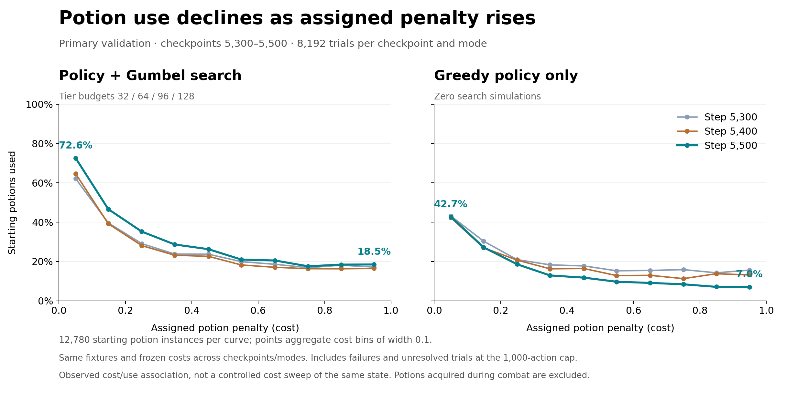

# Potion-cost sensitivity in recent primary validation

[Architecture explanation](../../docs/ARCHITECTURE.md#potion-cost-conditioning) · [Project overview](../../README.md#measured-sensitivity-to-potion-cost)

This analysis uses the three most recent completed **scheduled primary validation pairs** available on 2026-10-26: optimizer steps **5300, 5400 and 5500**. It reuses recorded outcomes; no new evaluation or training run was launched. The human benchmark is not used here because its inferred 0/1 costs do not provide a continuous randomized cost distribution.



## Definition and comparison

For each cost bin of width 0.1, the plotted quantity is:

```text
number of starting potion instances marked used
------------------------------------------------
number of starting potion instances in that bin
```

A potion counts once per combat replicate, regardless of the number of decisions in the fight. The final bin includes cost 1.0. Points are placed at the observed mean cost within each bin. Potions acquired during combat are excluded, using the frozen fixture's initial inventory size to select the corresponding initial ledger entries. Empty-inventory trials contribute no potion observations.

Each curve covers **8,192 trials** (4,096 frozen fixtures × episodes 1000000 and 1000001), containing **12,780 starting potion instances**. Starting costs were checked to match exactly across all six curves. Search uses easy/hard/elite/boss budgets 32/64/96/128; greedy policy uses zero simulations and legal-logit argmax. Actor identity is matched within each step, and all curves use the same fixture and native hashes. These checkpoints precede persistent search reuse.

All trials are included, including losses and unresolved/capped trials. A potion is counted as used only if its use was recorded before the trial ended or reached the 1,000-action limit. This avoids conditioning the denominator on combat success, but capped trajectories may differ from uncapped behavior.

| Step | Mode | Use at cost below 0.1 | Use at cost at least 0.9 | Unresolved trials / 8,192 |
|---:|---|---:|---:|---:|
| 5300 | Search | 62.2% | 17.1% | 1 |
| 5300 | Greedy policy | 43.1% | 15.6% | 138 |
| 5400 | Search | 64.6% | 16.4% | 1 |
| 5400 | Greedy policy | 42.3% | 13.1% | 7 |
| 5500 | Search | 72.6% | 18.5% | 4 |
| 5500 | Greedy policy | 42.7% | 7.0% | 242 |

The decline with cost appears even without search, supporting learned cost sensitivity in the base policy. It does not establish that the model's allocation is optimal. This is an association across randomized costs assigned to different potion/state instances, not a controlled sweep that changes only one cost for the same state. Curves reuse the same cases and costs across checkpoints; they must not be treated as independent datasets or pooled into an inflated sample size.

## Files and reproduction

- `validation-potion-observations.json.gz`: compact extraction from original per-replicate reports, with trial ID, replicate, terminal/truncation flags, and `[cost, used]` pairs for each starting potion. Includes original report SHA256 values and actor/fixture/native/evaluation provenance. Original source reports are identified by portable relative labels.
- `binned-use.csv`: 60 rows (three steps × two modes × ten bins), including numerator, denominator, mean cost and use rate.
- `summary.json`: endpoint rates, unresolved counts, source-data hash and analysis definitions.
- [Plot script](../../scripts/plot_potion_sensitivity.py): validates matched costs and regenerates the CSV, summary, PNG and SVG.

```bash
python scripts/plot_potion_sensitivity.py
```

Requires Python and Matplotlib, with no GPU or training environment. The observation data are a projection of existing benchmark results, not additional training data. The step-5500 extraction can also be checked against the full bundled `benchmarks/validation-005500/replicate-*.json.gz` and `benchmarks/policy-validation-005500/replicate-*.json.gz` reports.
