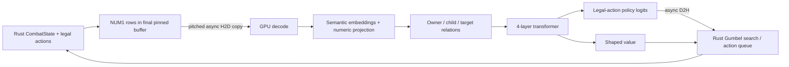
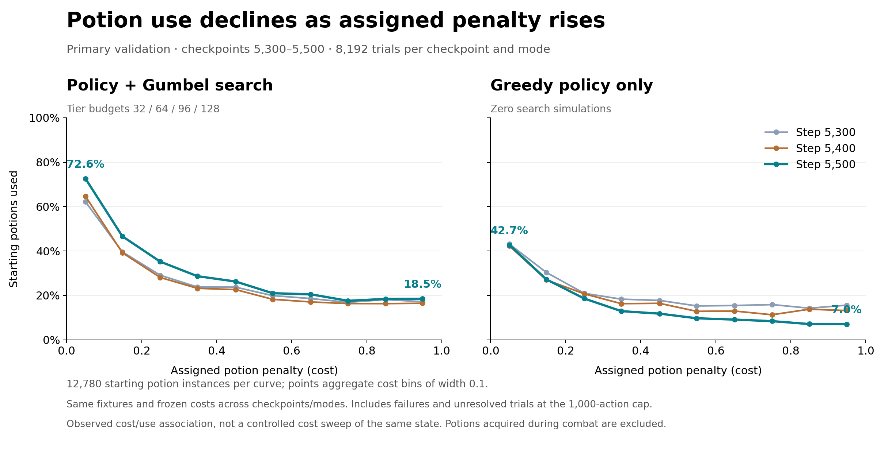

# Architecture

[Documentation guide](README.md) · [Project overview](../README.md)

**On this page:** [Network](#network) · [Potion-cost conditioning](#potion-cost-conditioning) · [How cost-sensitive behavior is trained](#how-cost-sensitive-behavior-is-trained) · [Validation evidence](#validation-evidence)

## Network

The released actor has **1,593,346 trainable parameters**. Its exact config is in `models/best/metadata.json` and its implementation is `ostyai/model.py`.

| Component | Shape / behavior |
|---|---|
| Native input | NUM1, `int32[B, S, 16]`, 64 bytes per row; row 0 is header/metadata |
| Shared semantic table | 5,159 × 128; disjoint namespaces in one table |
| Card dictionary | 585 base definitions; upgrades encoded separately |
| Catalog dictionary | 3,447 names; separate enchant/affliction/intent/choice namespaces |
| Semantic composition | Sum nine categorical-property embeddings, divided by 3 |
| Numeric projection | 40 signed-log1p features → 128, modulated by a per-kind gate |
| Relations | Child attributes pooled into owners; separate owner and reference projections |
| Summary | One learned 128-dimensional token replacing transport row 0 |
| Transformer | 4 pre-layer-normalized blocks, width 128, 4 heads (32 dimensions/head) |
| Feedforward | 128 → 512 → 128, GELU; residual connections |
| Attention | PyTorch scaled-dot-product attention, valid-token mask, no dropout |
| Policy | Concatenate action, owner, target and summary vectors (512) → 128 → 1 per legal action |
| Value | Summary vector 128 → 128 → 1; unconstrained shaped-return estimate |

There is no fixed global action softmax: the policy scores the simulator's ordered legal action list and masks padding. Value is **not** a win probability and can exceed 1. `slots=128` is not a hard token cap; sequence lengths are bucketed through 4096 rows.



Inference uses a Triton fused semantic-assembly kernel; training uses the equivalent autograd path. Torch compile and CUDA graphs amortize launch overhead by batch/length bucket. This moves token construction to GPU, but CPU state traversal and NUM1 export still exist. The package does not claim zero CPU observation work.

Entity IDs used only for transport are excluded from semantic numeric features where specified in the decoder.

## Potion-cost conditioning

Every potion instance has a scalar preservation cost `c` in `[0,1]`. It expresses how much the combat agent should value conserving that resource. It is not a probability, a mask, or a separate learned potion score. Multiple potions can have different costs, even when their types are identical.

The Rust [reward context](../native/crates/sts2-py/src/adversarial/reward.rs) maintains a ledger of potion identity, kind, slot, cost and whether it was used, together with active-instance mappings and total spending. Executing a legal potion-use action marks that instance used and adds its cost once. Existing instances keep their costs through inventory changes; new instances receive new costs. The context is cloned along with the combat for search, so hypothetical uses affect that branch rather than the factual combat ledger.

The [native numeric exporter](../native/crates/sts2-py/src/adversarial/numeric.rs) represents this context explicitly:

| NUM1 record kind | Information | Attachment |
|---|---|---|
| 18 | This potion instance's cost | Child of its potion record |
| 17 | Total spent cost, starting player HP, enemy-damage progress and starting enemy HP | Player context |
| 19 | Starting and minimum observed HP of an initial enemy | That enemy's record |

The values are stored as float32 bit patterns inside the int32 transport rows. The [model decoder](../ostyai/model.py) reinterprets them as floats, applies the same signed-log1p numeric encoding, and projects them to 128 dimensions. Potion-cost attributes participate in owner/child pooling and transformer attention. Both the policy and value heads therefore receive cost information through the shared representation; there is no separate potion-specific head. In greedy policy mode, action selection simply takes the highest legal policy logit, without a hand-written cost adjustment.

### Effect on utility

Let `S` be the sum of costs of used potions, `h` the nonnegative final HP, and `h0` the starting HP. The implemented terminal utility is:

```text
U = win + 0.5 * (h / h0) * (1 - S)
        + (0 if win else 0.05 * enemy_damage_progress)
```

Holding final HP and outcome fixed, one additional used potion of cost `c` changes utility by `-0.5 * (h / h0) * c`. For example, a win ending at 80% of starting HP scores 1.4 with no spending, 1.3 after spending 0.25, or 1.0 after spending 1.0. This is an HP-scaled terminal cost, not an immediate subtraction of `c` from every action reward. At death (`h=0`), the HP/cost term vanishes. Multiple costs add; `S` can exceed 1 and make the HP term negative because the utility is unclipped. The explicit win term remains, and an expensive potion can still be the best choice when it changes survival or damage taken.

## How cost-sensitive behavior is trained

1. **Sample costs as part of the combat task.** Training assigns independent pseudo-random Uniform[0,1] costs to starting and newly acquired potion instances. They remain fixed for each instance during that rollout. Different rollouts can expose the model to different preservation preferences.
2. **Plan with the same context.** Gumbel search uses the cost-conditioned policy for action priors and value head for leaf evaluation. Terminal search states use the exact utility above. Search branches carry their own ledger, accumulated spending and potion costs.
3. **Train both heads.** Replay retains cost-conditioned observations. Policy cross-entropy distills the search-improved action targets; value MSE trains each completed trajectory's observations toward its actual terminal utility. The existing within-pool importance weights apply to both losses. Unresolved collection trajectories are censored rather than assigned a fictitious terminal outcome.

Costs themselves are externally assigned inputs and are not optimized. There are no human labels saying which potion to use in training, no separate loss directly requiring a certain potion-use frequency, and no distance-to-terminal discount. The model learns the trade-off through search supervision and cost-dependent returns. See [training scheme](TRAINING.md) and the [collection/replay implementation](../native/crates/sts2-py/src/adversarial/closed_loop.rs).

Primary validation samples independent costs and freezes the starting costs by fixture and replicate across checkpoints. The 512-run human benchmark uses a different context: 0 for a starting potion inferred/recorded as used by the human, 1 otherwise, and 1 for newly acquired potions. Those evaluation labels do not become supervised human-action targets.

## Validation evidence



The last three completed scheduled primary validation pairs, steps 5300, 5400 and 5500, show lower use at higher costs. The decline is present with **zero-search greedy policy**, supporting sensitivity in the learned network itself. Each curve counts 12,780 starting potion instances in the same 4,096 fixtures × two replicates. At step 5500, the low-cost `[0,0.1)` versus high-cost `[0.9,1]` use rates are **72.6% versus 18.5% with search** and **42.7% versus 7.0% without search**.

All trials are included, including failures and action-capped cases; the measurement is use observed before termination or the 1,000-action cap. Only starting inventory is counted, avoiding different acquisition rates across policies. This is a binned association across independently assigned costs, not a matched intervention on the same state and potion. It demonstrates sensitivity, not optimal potion allocation or a causal estimate for an individual combat. [Counts, unresolved totals, source hashes and reproduction](../benchmarks/potion-sensitivity/README.md).
