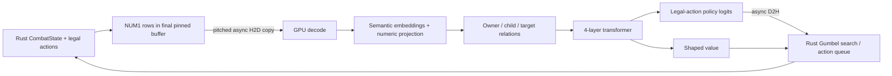

# Architecture

[Documentation guide](README.md) · [Project overview](../README.md)

The released actor has **1,593,346 trainable parameters**. Its exact config is in `models/best/metadata.json` and its implementation is `ostyai/model.py`.

| Component | Shape / behavior |
|---|---|
| Native input | NUM1, `int32[B, S, 16]`, 64 bytes per row; row 0 is header/metadata |
| Shared semantic table | 5,159 × 128; disjoint namespaces in one table |
| Card dictionary | 585 base definitions; upgrades encoded separately |
| Catalog dictionary | 3,447 names; separate enchant/affliction/intent/choice namespaces |
| Semantic composition | Sum nine categorical-property embeddings, divided by 3 |
| Numeric projection | 40 signed-log1p features → 128, modulated by a per-kind gate |
| Relations | Child attributes pooled into owners; separate owner and reference projections |
| Summary | One learned 128-dimensional token replacing transport row 0 |
| Transformer | 4 pre-layer-normalized blocks, width 128, 4 heads (32 dimensions/head) |
| Feedforward | 128 → 512 → 128, GELU; residual connections |
| Attention | PyTorch scaled-dot-product attention, valid-token mask, no dropout |
| Policy | Concatenate action, owner, target and summary vectors (512) → 128 → 1 per legal action |
| Value | Summary vector 128 → 128 → 1; unconstrained shaped-return estimate |

There is no fixed global action softmax: the policy scores the simulator's ordered legal action list and masks padding. Value is **not** a win probability and can exceed 1. `slots=128` is not a hard token cap; sequence lengths are bucketed through 4096 rows.

Inference uses a Triton fused semantic-assembly kernel; training uses the equivalent autograd path. Torch compile and CUDA graphs amortize launch overhead by batch/length bucket. This moves token construction to GPU, but CPU state traversal and NUM1 export still exist. The package does not claim zero CPU observation work.

Potion costs and accumulated spending are explicit reward-context records (record kinds 17–19), decoded as floating-point bit patterns. They remain bound to potion instances and follow cloned combat/search state. Entity IDs used only for transport are excluded from semantic numeric features where specified in the decoder.
